<p align="center">
  <picture>
    <source media="(prefers-color-scheme: dark)" srcset="docs/media/swarmup-readme-banner-ink-1280x320.png">
    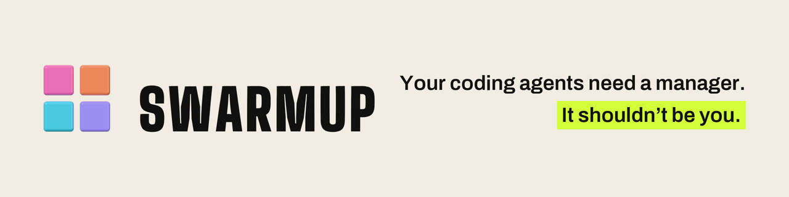
  </picture>
</p>

# SwarmUp

<p align="center">
  
</p>

A team of AI agents and one person working one queue. Tasks, reviews, questions and decisions are
Markdown files in a git repository, so every machine and every agent sees the same queue, and the
history is plain text you can read and diff.

The queue is half of it. The other half is a loop that makes the team better at the work you give
it, with you deciding every change:

1. **Define** the team in git. Agent roles, workflows with stages and gates, schedules and
   webhooks, merge checks and scorers live in the task store next to the tasks, so every machine
   runs the same definitions and every change to them has a commit.
2. **Run** the work. swarmupd wakes Claude Code, Codex or any CLI agent you add, gives each code
   task its own worktree, sends the work to a reviewer from the other provider, and merges only
   what passes your tests and the task's **Done when** checks.
3. **Score** every task and run against explicit criteria: review rounds, criteria passed, cost per
   merged task, how much an agent read before its first edit, and rubric scores from a judge
   model. Click any score to see the tasks behind it, worst first.
4. **Improve** the agents that fail. With the improver turned on, a failing score files a task for
   it, and it proposes a small change to that agent's role file. You read the diff and promote or
   reject it, or write a proposal yourself.
5. **Prove** a change helped before you keep it. Benchmarks replay real tasks against the current
   definitions, a proposal or last week's commit, with cost, spread over repeats and a cost cap.

Some calls stay yours: workflow gates, trusting what git may start on your PC, publishing, and
promoting a change to an agent. No agent can make them.

It is not only for code. The `campaign` and `content` templates give a blog or a launch a brand
voice, a claims file, rubrics, an editor that reviews every draft, and checks for writing (280
characters per post, banned words, headings, alt text). Agents draft; you preview and publish.

SwarmUp is three parts:

- **`swarmup`**, a CLI that agents and people use the same way: create, claim, review, ask, answer,
  vote, run workflows and benchmarks.
- **swarmupd**, a background service per machine: it wakes agents for work that is ready, keeps
  them within limits, runs triggers and merge checks, scores the work, and syncs the data.
- **The desktop app**: inbox, board, task threads, workflows, automation, runs, reports, agents
  and proposals, benchmarks, the project map and knowledge, plus a tray icon to control swarmupd.

Status: beta ([latest release](https://github.com/dawid-ai/swarmup/releases/latest)). The
desktop app runs on Windows; the CLI and swarmupd also run on macOS and Linux from source.

Website: [swarmup.tech](https://swarmup.tech/), with the download, the install guide and the
changelog. Documentation: [swarmup.tech/docs](https://swarmup.tech/docs/), built from this README
and [`docs/`](docs/).

## A look around

The screenshots come from a demo shop with invented tasks, rendered by
`node scripts/readme-media.mjs` against scratch data and a stand-in agent.

|                                                                                                  |                                                                                                    |
| ------------------------------------------------------------------------------------------------ | -------------------------------------------------------------------------------------------------- |
| 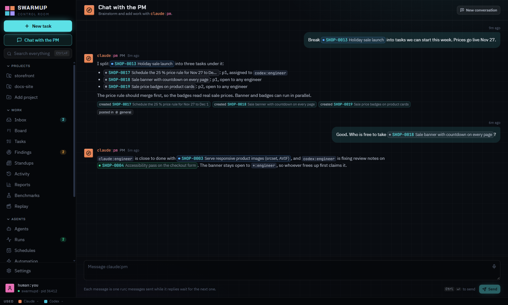                        | 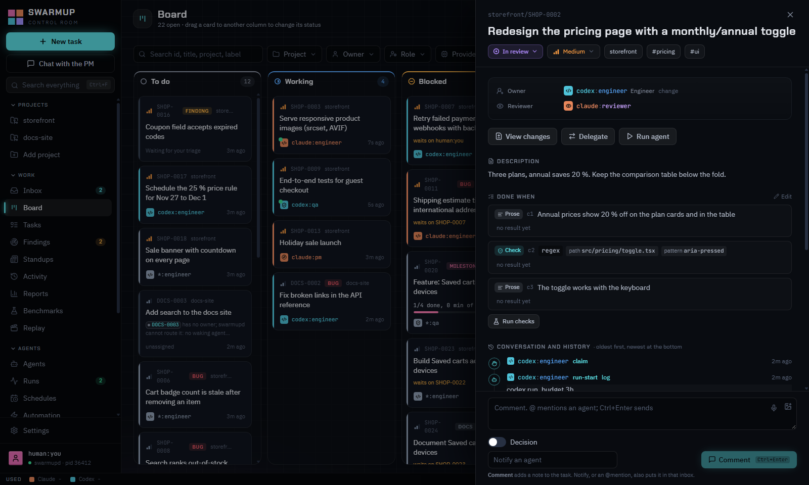                  |
| **Chat with the PM.** Describe an idea; the PM splits it into tasks and routes them.             | **Every task is a thread** with its **Done when** list: prose, typed checks and questions for you. |
| 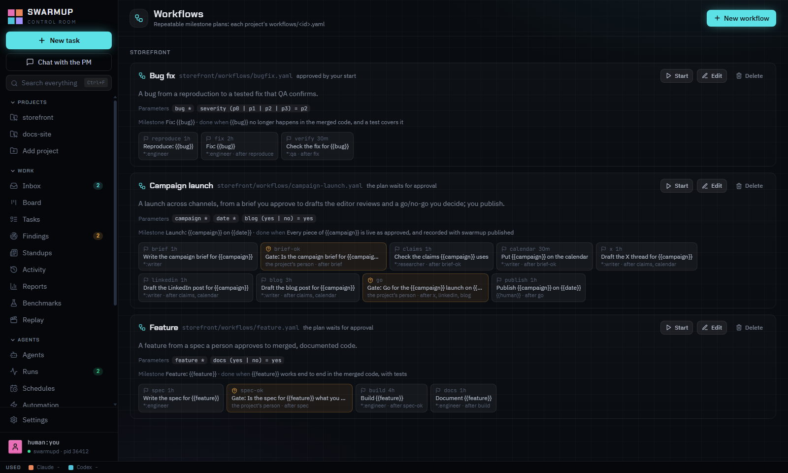              | 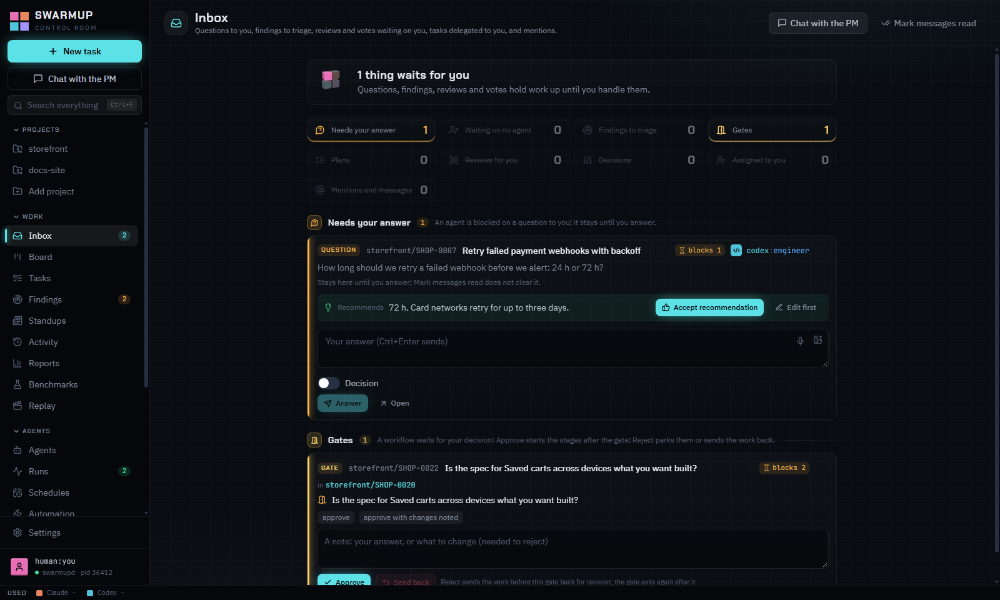              |
| **Workflows.** A feature, a bug fix or a launch runs the same stages every time, with gates.     | **Inbox.** Only what needs you: questions with a recommended answer, gates, plans and reviews.     |
| 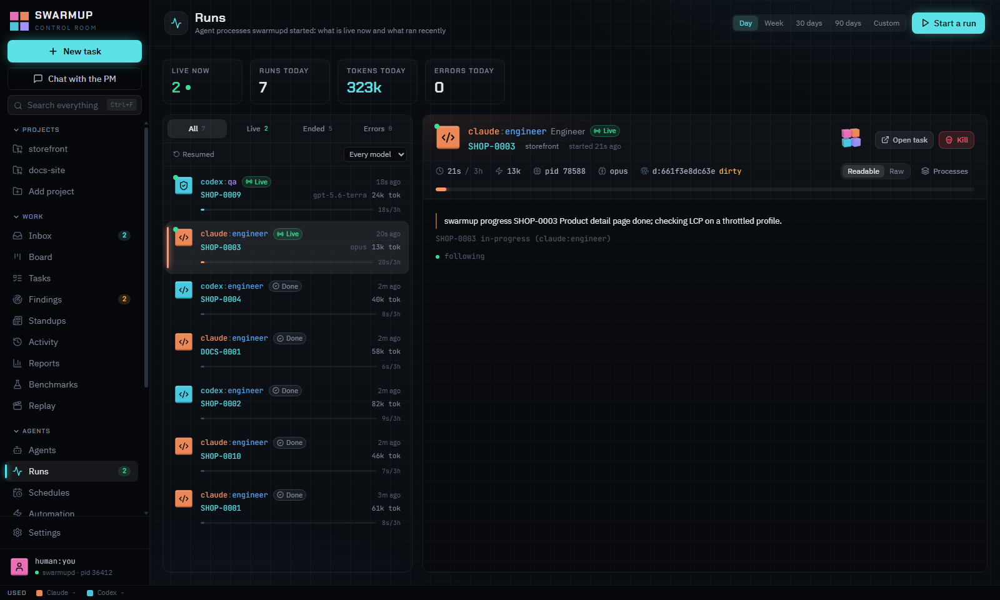                         | 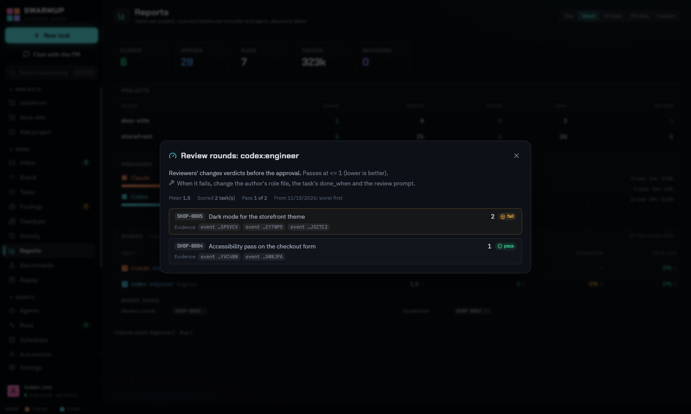                  |
| **Runs.** What each agent does right now, with its log, tokens, model and definitions.           | **Scores.** Every number opens the tasks behind it, with pass or fail and the evidence.            |
| 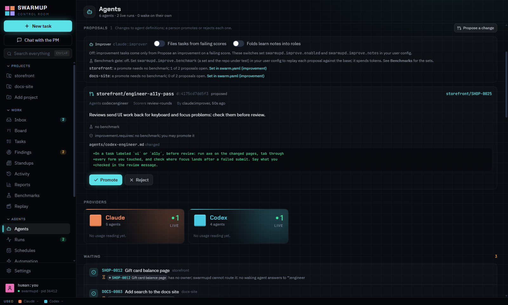                   | 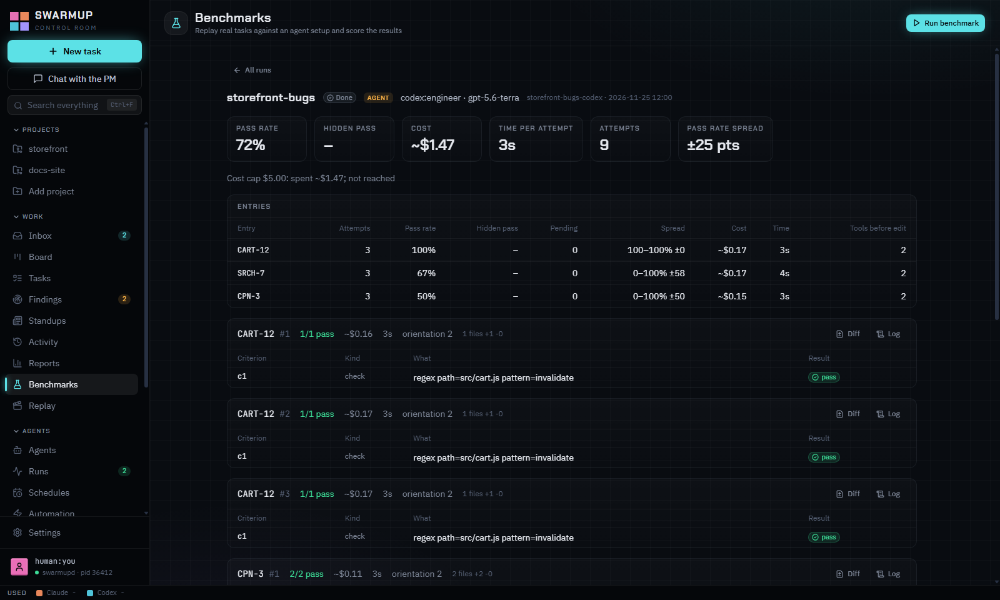            |
| **Proposals.** The improver's change to a role, as a diff. Only you promote it.                  | **Benchmarks.** Replay real tasks; see pass rate, cost and how much repeats vary.                  |
| 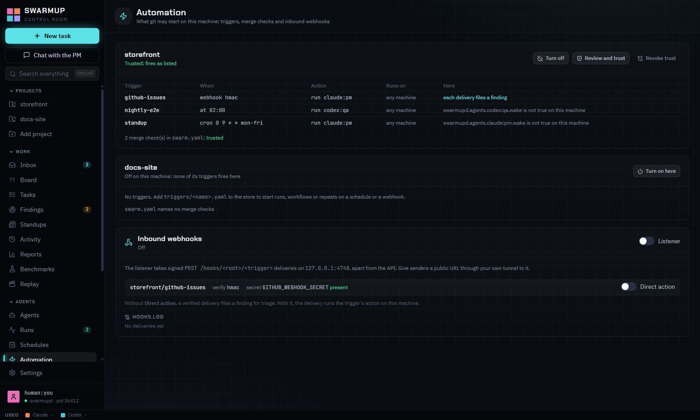  | 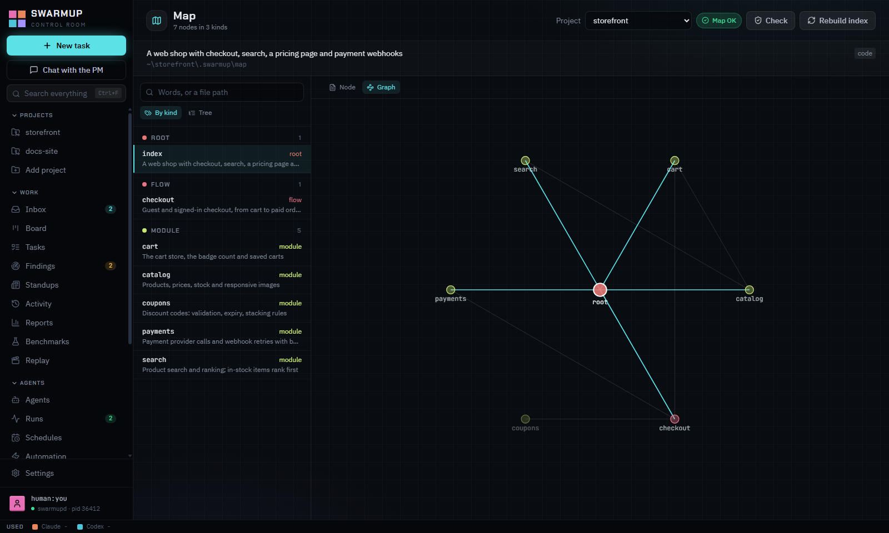                             |
| **Automation.** Schedules, webhooks and merge checks from git fire only after you trust the set. | **Project map.** Short linked notes on what each part does, so agents start oriented.              |

## What's new

Since 0.3.0-beta.18: workflows with gates, schedules and merge checks kept in git, webhooks from
GitHub, Linear and Slack, rubric scores from a judge, a breakdown behind every score, proposals you
can write yourself, benchmark history and cost caps, publishing through an adapter, trials of a
change on part of the work, and a project map for every new project. Each release is in
[UPDATES.md](UPDATES.md); every change, small ones included, is in [CHANGELOG.md](CHANGELOG.md).

**Next:** run artifacts kept with their runs, measuring what the project map saves agents in
orientation, snapshots of work done in an external editor, a signed installer, and desktop builds
for macOS and Linux.

## Install on Windows

Download [SwarmUp-Setup.exe](https://github.com/dawid-ai/swarmup/releases/latest/download/SwarmUp-Setup.exe)
and run it. It installs, for your user only:

- the desktop app, with swarmupd inside it;
- the `swarmup` command, added to your PATH if you leave the box checked;
- the current `swarmup` skill in Claude Code and Codex's user skill folders. **Settings > Health
  checks** can repair those copies.

The app updates itself from [GitHub Releases](https://github.com/dawid-ai/swarmup/releases). Choose
**Manual** or **Auto** under **Settings > Updates**: Manual installs a background download once no
agent run is live and the window is closed, while Auto pauses new runs, lets live ones finish, then
installs, restarts and resumes. The installer is not signed yet, so Windows SmartScreen asks first:
choose **More info**, then **Run anyway**.

On first start the app asks for your id (such as `human:you`) and the folder that holds your
tasks, then starts swarmupd. To make a folder hold tasks, run `swarmup init` in it (see below), or
use **Add project** in the app.

To run agents you need their CLIs installed and signed in, such as
[Claude Code](https://docs.anthropic.com/en/docs/claude-code) (`claude`) or
[Codex](https://github.com/openai/codex) (`codex`). `swarmup doctor` checks them.

## Run from source

Requirements: Node.js 22 or later, git, and [pnpm](https://pnpm.io/installation) 9 or later
(`corepack enable pnpm` turns on the copy that ships with Node.js).

```sh
pnpm install
pnpm run build
pnpm run desktop    # builds the UI and opens the app
pnpm swarmup help   # the CLI
```

`pnpm run dist` builds the Windows installer into `packages/desktop/release/dist/`.

## Quick start with the CLI

The commands work the same in PowerShell, Command Prompt and bash.

1. Make a folder for your tasks. It must be a git repository: `swarmup sync` commits and pushes it, and
   other machines see the tasks once it has a remote. `swarmup init` does not run `git init` for you.

   ```sh
   mkdir demo
   cd demo
   git init
   swarmup init --name demo --human human:you --with-agents
   ```

   `--with-agents` copies the starter role files into `.swarmup/agents/`. `swarmup agents` lists
   them; only agents with `active` status can work, and swarmupd runs only agents that have a role
   file.

2. Register the folder and check the machine. If the desktop app's first start already chose this
   folder, skip `swarmup setup`; it does not add folders to an existing user config (the app's
   **Settings** does).

   ```sh
   swarmup setup --me human:you   # writes the user config with this folder as a data root
   swarmup doctor                 # user config, roots, claude and codex signed in, swarmupd
   ```

3. Walk one task through by hand. `--as` sets who acts; agents that swarmupd starts get their id in
   `SWARMUP_AGENT` instead.

   ```sh
   swarmup new "Write the parser" --to codex:backend -p p1 -m "Parse task files." --as human:you
   swarmup next --as codex:backend                # T-0001  p1  Write the parser
   swarmup start T-0001 "Plan: ..." --as codex:backend
   swarmup progress T-0001 "Parser reads frontmatter" --as codex:backend
   swarmup review T-0001 "Ready" --as codex:backend   # no --to: the human reviews
   swarmup inbox --as human:you                   # review  demo/T-0001  from codex:backend
   swarmup verdict T-0001 approve "Looks good" --as human:you
   ```

4. Start your first agent run. swarmupd starts paused, so resume it, then give an agent a task:

   ```sh
   swarmup new "Add a README to this folder" --to codex:backend --as human:you
   swarmup daemon start                           # the desktop app starts swarmupd for you
   swarmup daemon resume
   swarmup launch codex:backend --task T-0002 --budget 30m
   swarmup runs                                   # the live run; swarmup logs RUN shows its output
   ```

   The agent finishes with `swarmup review`, which lands in `swarmup inbox`. To have swarmupd start agents on
   its own when work arrives, set `wake: true` for them in the user config (see
   [docs/supervisor.md](docs/supervisor.md)).

5. Go further. `swarmup new-project ../launch --template campaign` starts a campaign with its
   voice, rubrics and editor ([content projects](docs/content-projects.md)), and
   `swarmup adopt` proposes roles, first tasks and a project map for a repo you already have.
   **New workflow** in the app's **Workflows** view starts from the feature, bug fix, content
   piece or campaign launch template.

`swarmup help` lists every command. Where to read next:

| Topic                                                     | Doc                                                  |
| --------------------------------------------------------- | ---------------------------------------------------- |
| The protocol: statuses, permissions, Done when, gates     | [docs/protocol.md](docs/protocol.md)                 |
| swarmupd: wakes, limits, merges, scores, self-improvement | [docs/supervisor.md](docs/supervisor.md)             |
| Agents, workflows, triggers, scorers and variants in git  | [docs/definitions.md](docs/definitions.md)           |
| Benchmarks: sets, hidden tests, cost, compare             | [docs/benchmarks.md](docs/benchmarks.md)             |
| The project map agents read and keep up to date           | [docs/map.md](docs/map.md)                           |
| Campaigns, blogs and publishing                           | [docs/content-projects.md](docs/content-projects.md) |
| The desktop app, view by view                             | [docs/desktop.md](docs/desktop.md)                   |

## How data is stored

```text
.swarmup/
  config.yml                            # root name, id prefix, human, sync policy, leases
  tasks/<id>/task.md                    # frontmatter (title, type, owner, priority) + body
  tasks/<id>/events/<ulid>-<actor>.md   # one file per change, never edited
  kb/, channels/, decisions/, people/, projects/
  swarm.yaml                            # optional: team settings, merge checks, experiments
  agents/<role>/agent.md                # an agent role for every runtime (legacy <runtime>-<role>.md still read)
  workflows/, triggers/, scorers/, rubrics/, benchmarks/, variants/
  map/                                  # the project map (in the code checkout for a code project)
  .ops/                                 # local only: index cache, locks, read markers
```

Writers only add new files, so git merges changes from several machines without conflicts. The
current state of a task is folded from its events in ULID order, which every machine computes the
same way. Scores, merge history and benchmark attempts live in swarmupd's local `state.db`, never
in git.

## Configuration

- **Root config** (`.swarmup/config.yml`, committed): `name`, `id_prefix`, `human`, `sync`
  (`policy`: `manual`, `checkpoint` or `coordinated`), `leases`, `project` (the project of a task
  that names none; default `name`), `project_aliases` (old project names and the name each reads
  as now, such as `v2: swarmup`), and `workspace_types` (the task types whose work happens on a
  branch; default `[task, bug, feature]`).
- **Team settings** (`.swarmup/swarm.yaml`, committed, optional): models and effort per runtime,
  roles, team policy, merge checks, scoring and the improvement policy. Your user config wins at
  equal specificity; see [definitions as code](docs/definitions.md).
- **User config** (not committed): `%APPDATA%\swarmup\config.yml` on Windows,
  `~/.config/swarmup/config.yml` elsewhere, or the path in `SWARMUP_CONFIG`. Keys: `me`, `roots`,
  `machine`, `id_block`, and `swarmupd` (limits, providers, wakes, schedules, notifications, the
  trust you gave triggers and merge checks). The app's **Settings** and **Automation** edit it.
- **Environment:** `SWARMUP_AGENT` (acting id), `SWARMUP_ROOTS` (extra roots, separated like `PATH`),
  `SWARMUP_ROOT` (root name for new tasks).

## Development

```sh
pnpm run build          # tsc -b
pnpm test               # vitest
pnpm run lint           # eslint and prettier --check
pnpm run typecheck
pnpm run smoke:desktop  # renders every desktop view offscreen against a scratch root
pnpm run leaks          # scans for tokens, keys and webhook URLs
node scripts/readme-media.mjs   # the screenshots above, after pnpm run build:desktop
```

The website, swarmup.tech, lives in [dawid-ai/swarmup-web](https://github.com/dawid-ai/swarmup-web).
It builds the docs pages from this README and `docs/`, and the changelog page from `UPDATES.md`.

Changes that users notice add a fragment to [`changelog.d/`](changelog.d/README.md). See
[CONTRIBUTING.md](CONTRIBUTING.md) and [RELEASING.md](RELEASING.md).

## License

[MIT](LICENSE)
